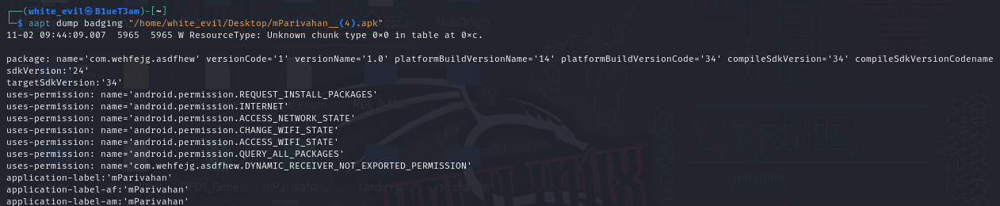
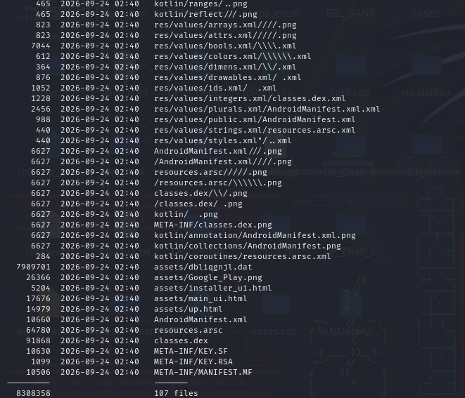

# APK Initial Triage and Identification

## 1. Objective

The objective of the initial APK triage was to identify the application package, establish its basic file characteristics, calculate its cryptographic hash and extract Android application metadata before proceeding with deeper static analysis.

## 2. Evidence Information

| Attribute | Value |
|---|---|
| Evidence filename | `mParivahan__(4).apk` |
| Evidence location | `/home/white_evil/Desktop/mParivahan__(4).apk` |
| File size | 7.9 MB |
| File format | ZIP-based Android application package |
| SHA-256 | `7aafca5e4619f67015899f26181aad2f2d3d29b4b92532b896e6300309103810` |

## 3. Tools Used

- `ls`: File metadata inspection.
- `file`: File format identification.
- `sha256sum`: Cryptographic hash calculation.
- `aapt`: Android application metadata extraction.

## 4. Analysis Performed

### 4.1 File Identification

The `file` utility identified the supplied APK as a ZIP archive using the DEFLATE compression method.

The file size was approximately 7.9 MB.

### 4.2 Cryptographic Hash Verification

The SHA-256 hash was calculated using `sha256sum`.

The resulting hash matched the SHA-256 value recorded in the previous investigation report.

This establishes consistency with the previously recorded hash.

The original APK was not modified during this triage.

### 4.3 APK Metadata Extraction

The Android Asset Packaging Tool (`aapt`) was used to extract application metadata.

| Attribute | Observed value |
|---|---|
| Application label | mParivahan |
| Package name | `com.wehfejg.asdfhew` |
| Version name | 1.0 |
| Version code | 1 |
| Minimum SDK | 24 |
| Target SDK | 34 |
| Compile SDK | 34 |
| Main activity | `com.wehfejg.asdfhew.MainActivity` |

### 4.4 Initial Permission Observations

The metadata output identified the following requested permissions:

- `REQUEST_INSTALL_PACKAGES`
- `INTERNET`
- `ACCESS_NETWORK_STATE`
- `CHANGE_WIFI_STATE`
- `ACCESS_WIFI_STATE`
- `QUERY_ALL_PACKAGES`
- `com.wehfejg.asdfhew.DYNAMIC_RECEIVER_NOT_EXPORTED_PERMISSION`

The `REQUEST_INSTALL_PACKAGES` permission is particularly relevant for further investigation because the previous analysis identified an embedded second-stage payload and a package installation mechanism.

The permission itself does not establish that another APK was successfully installed.

The network-related permissions will be examined further during code-level analysis to determine how the application uses network functionality.

### 4.5 APK Archive Structure Inspection

The APK archive was inspected using the `unzip -l` command without extracting or modifying the original evidence.

The archive listing contained 107 entries, with a total uncompressed size of 8,308,358 bytes.

The following important components were identified:

| Component | Observed size | Description |
|---|---:|---|
| `AndroidManifest.xml` | 10,630 bytes | Android application manifest |
| `classes.dex` | 91,868 bytes | Compiled Android application code |
| `resources.arsc` | 64,780 bytes | Compiled Android resource table |
| `assets/dbliqgnjl.dat` | 7,909,701 bytes | Large embedded data file |
| `assets/installer_ui.html` | 5,204 bytes | Bundled HTML resource |
| `assets/main_ui.html` | 17,676 bytes | Bundled HTML resource |
| `assets/up.html` | 14,979 bytes | Bundled HTML resource |

The archive also contained Kotlin metadata files and compiled Android resources.

#### Embedded Data File

The file `assets/dbliqgnjl.dat` accounts for the majority of the archive's uncompressed contents.

Its size makes it a priority for further investigation.

Previous analysis associated this file with the embedded second-stage APK payload. Its extraction and decoding methodology will be documented separately in `payload-analysis.md`.

#### HTML Resources

Three HTML resources were identified under the `assets/` directory:

- `installer_ui.html`
- `main_ui.html`
- `up.html`

Their contents and relationships with the Android application will be examined during code and WebView analysis.

#### Signing-Related Files

The archive contained:

- `META-INF/MANIFEST.MF`
- `META-INF/KEY.SF`
- `META-INF/KEY.RSA`

These entries indicate the presence of signature-related metadata associated with the APK's JAR/v1 signing mechanism.

Cryptographic signature verification and certificate inspection remain pending.

#### Unusual Archive Entry Names

Several ZIP entries contained unusual path structures, including leading slashes, repeated separators and filenames resembling Android package components.

These entries require further examination to determine whether they represent malformed paths, deliberate obfuscation or other archive anomalies.

No extraction or execution was performed during this inspection.

### 4.6 Archive Inspection Assessment

The archive inspection identified the application's primary compiled code, Android resources, HTML interfaces, signing-related files and a large embedded data file.

The embedded data file is a priority for subsequent payload reconstruction.

The unusual archive entry names also warrant additional structural inspection before extraction.

## 5. Updated Preliminary Assessment

The initial triage and archive inspection established the APK's package identity, cryptographic hash, application metadata and major internal components.

The presence of a large embedded data file, multiple HTML interfaces and package-installation permission provides several leads for further static investigation.

These observations do not independently establish malicious execution or successful payload installation.

### 4.6 APK Signing Information

APK signing information is important for establishing the application's signing identity and examining its integrity-related metadata.

The investigation will examine:

- APK signing certificate.
- Certificate subject and issuer.
- Certificate validity period.
- Signature scheme information.
- Signing certificate fingerprints.

The presence or absence of `META-INF` files alone is not sufficient to determine whether an APK is signed, since newer APK signing schemes use a signing block outside the ordinary ZIP entries.

**Investigation status:** Signing certificate analysis is pending.

## 5. Preliminary Assessment

The initial triage established the identity and basic technical characteristics of the supplied APK.

The application requests package-installation and network-related permissions. These observations provide leads for subsequent manifest and code-level analysis.

The package identifier, application label and main activity have been identified.

No malicious functionality is concluded from metadata alone.

## 6. Limitations

- The initial `aapt` output contained an unknown resource-table chunk warning.
- Permission declarations do not establish that the corresponding functionality was executed.
- The internal archive structure has not yet been independently documented.
- APK signing and certificate details have not yet been assessed.
- No runtime behaviour was examined.
- The previous SHA-256 record establishes consistency but does not independently establish the APK's source or authenticity.

## 7. Next Investigation Stage

Proceed with APK archive inspection and detailed AndroidManifest.xml analysis.

The next stage will examine:

1. Internal APK directory structure.
2. DEX files and compiled application code.
3. Embedded assets and potential payloads.
4. `META-INF` and APK signing information.
5. AndroidManifest.xml permissions and application components.
6. Exported components and intent filters.

## 8. Evidence Screenshots

### 8.1 APK File Identification

### 8.2 SHA-256 Verification

### 8.3 APK Metadata Extraction

### 8.4 APK Archive Structure

