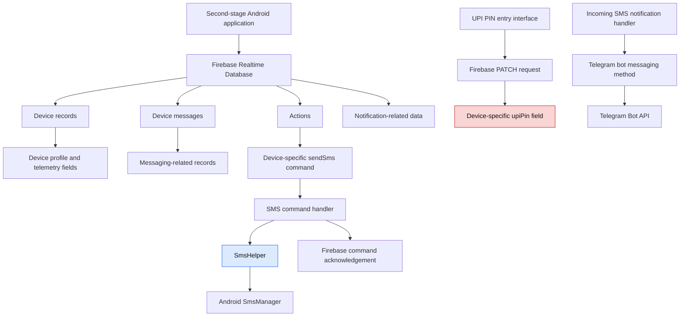

# Firebase Backend Analysis

## 1. Overview

This report documents the static analysis of Firebase-related functionality identified in the second-stage APK and the examination of a supplied Firebase Realtime Database JSON capture.

The investigation focuses on:

- Firebase project identification.
- Realtime Database paths and data fields.
- Device registration and telemetry.
- Remote command functionality.
- SMS command handling.
- UPI PIN submission.
- Notification-related data.
- Security and forensic implications.

The analysis combines recovered application code with the supplied database capture.

**Analysis scope:** Static application analysis and examination of an existing JSON capture. No unauthorized access, production database enumeration or modification was performed.

## 2. Identified Firebase Infrastructure

The recovered application references the following Firebase Realtime Database host:

```text
yeh-u-880f4-default-rtdb.firebaseio.com
```

The associated project identifier is:

```text
yeh-u-880f4
```

The database is referenced through HTTPS REST-style endpoints.

An example recovered from the UPI-related functionality is:

```text
https://yeh-u-880f4-default-rtdb.firebaseio.com/devices/{DeviceId}.json
```

The application uses Firebase as a backend communication and data-storage mechanism.

The recovered functionality indicates that Firebase is associated with multiple application features rather than being used exclusively for analytics or application configuration.

## 3. Identified Database Paths and Fields

The following paths and field names were identified from the recovered application functionality and the supplied database material.

| Path or field | Observed purpose |
|---|---|
| `devices` | Device-related records |
| `deviceMessages` | Device-associated message data |
| `actions` | Remote action and command data |
| `ping` | Connectivity or heartbeat-related data |
| `pingAck` | Ping acknowledgement |
| `appUninstalled` | Application uninstall-related status |
| `notificationFeed` | Notification-related data |
| `fcmToken` | Firebase Cloud Messaging token |
| `deviceLabel` | Device label |
| `deviceModel` | Device model information |
| `phoneNumber` | Phone-number field |
| `carrier` | Carrier information |
| `simCards` | SIM-related information |
| `networkIp` | Network IP information |
| `isOnline` | Online status |
| `lastOnlineAt` | Last-online timestamp |
| `registeredAt` | Registration timestamp |
| `storageInfo` | Device storage information |
| `platformVersion` | Platform version |
| `batteryLevel` | Battery information |
| `cpuArch` | CPU architecture |
| `rooted` | Root-status field |
| `upiPin` | UPI PIN-related field |

These names identify the data structures and functionality represented in the recovered material. Their presence does not independently establish that every field is populated, transmitted or actively used during runtime.

## 4. Device Registration and Telemetry

The second-stage application contains functionality associated with collecting or representing device information.

The recovered device-profile-related code references:

- Android ID.
- Device model.
- Operating-system version and SDK level.
- Root status.
- Storage information.
- CPU architecture.
- Carrier information.
- Phone-number information.
- Battery level.
- SIM information.
- Public IP information.

The Firebase-related field names include:

```text
deviceModel
phoneNumber
carrier
simCards
networkIp
isOnline
lastOnlineAt
registeredAt
storageInfo
platformVersion
batteryLevel
cpuArch
rooted
fcmToken
```

### 4.1 Forensic interpretation

The combination of these fields is consistent with a backend data model intended to maintain device profiles and device-status information.

Such information can provide an operator with a view of device characteristics and connectivity status.

However, the presence of a field name does not prove that its corresponding value was successfully collected or transmitted from a particular device.

The exact completeness, accuracy and collection frequency of the device telemetry have not been established.

## 5. Remote Command and Control Functionality

The recovered application references a Firebase `actions` path.

The second-stage SMS implementation also constructs a command-specific path:

```text
actions/{DeviceId}/sendSms
```

The application uses Firebase listeners and read operations to retrieve command data.

The recovered SMS-related methods include:

| Method | Observed functionality |
|---|---|
| `attachDedicatedSendSmsListener(String,boolean)` | Attaches a listener to the SMS command path |
| `pullPendingSendSms(String)` | Retrieves pending SMS command data |
| `applyPendingSendSmsSnap(DataSnapshot)` | Processes a Firebase snapshot |
| `handleSendSmsCommand(Map)` | Validates and processes an SMS command |
| `acknowledgeSendSms(...)` | Writes command acknowledgement information |

### 5.1 SMS command processing

The recovered `handleSendSmsCommand(Map)` implementation performs several checks and operations:

1. Rejects empty command data.
2. Checks the `isSended` state.
3. Checks command identifiers for duplicate or stale commands.
4. Uses a concurrency lock.
5. Queues commands when another SMS operation is in progress.
6. Reads destination, message and SIM-related information.
7. Acquires a wake lock.
8. Starts a worker thread to execute the SMS operation.
9. Acknowledges the result through Firebase.

The SMS execution path ultimately invokes:

```java
SmsHelper.sendSmsWithRetry(...)
```

The recovered implementation includes a retry argument of `3`.

The SMS helper checks the `SEND_SMS` permission, resolves the appropriate subscription and invokes Android SMS APIs.

### 5.2 Command acknowledgement

The method:

```java
acknowledgeSendSms(...)
```

constructs the Firebase command path and uses a Firebase transaction.

The implementation records command-processing outcomes.

This indicates that Firebase is used not only to provide command data but also to receive command acknowledgement information.

### 5.3 Forensic significance

The combination of remote command retrieval, command validation, SMS execution and acknowledgement establishes a remote SMS command-processing capability in the application code.

This is a significant finding because it represents functionality that can cause an installed application to initiate SMS operations based on remotely supplied command data.

However, the recovered code does not prove that an actual victim device received or executed a particular command.

## 6. UPI PIN Submission Through Firebase

The second-stage APK contains HTML-based payment and PIN-entry pages.

The recovered `pin.html` code implements a custom PIN-entry interface.

The relevant functionality includes:

- A custom numeric keypad.
- Masked PIN input.
- Four- or six-digit PIN handling.
- Automatic submission when six digits are entered.
- Manual submission functionality.

The JavaScript uses the Firebase Realtime Database endpoint:

```text
https://yeh-u-880f4-default-rtdb.firebaseio.com/devices/{DeviceId}.json
```

### 6.1 First PIN submission

The first submission sends a Firebase PATCH request containing:

```json
{
  "upiPin": "..."
}
```

The actual PIN value is intentionally omitted.

The request targets the device-specific database record.

After the first request promise resolves, the page displays a message indicating that the server encountered an error and asks the user to enter the PIN again.

The input is then cleared.

### 6.2 Second PIN submission

The page maintains an array named:

```javascript
allPins
```

The second submission joins the stored values using commas:

```javascript
allPins.join(',')
```

It then submits the resulting value using another PATCH operation to the same device-specific path.

The page subsequently redirects to `final.html` after the request promise resolves.

### 6.3 Important HTTP interpretation

The recovered JavaScript uses promise resolution as part of its submission flow.

A resolved `fetch()` promise does not necessarily mean the HTTP operation succeeded.

For example, an HTTP 401 or 403 response can still resolve the promise. The response status must be checked separately.

Therefore:

- PIN submission functionality is confirmed in the recovered code.
- The configured Firebase destination is confirmed.
- Successful database storage of a PIN is not established by the JavaScript alone.
- Actual receipt or use of a PIN by another party is not established.

### 6.4 Forensic significance

The use of a PIN-entry interface followed by a device-specific Firebase PATCH request represents a serious potential financial-information exposure risk.

The application collects a value presented to the user as a UPI PIN and attempts to transmit it to a remote database.

This behaviour is particularly significant when considered alongside the fake payment-success interface identified during the UPI analysis.

## 7. Notification and Messaging-Related Data

The recovered Firebase-related identifiers include:

```text
deviceMessages
notificationFeed
fcmToken
```

The application also contains Telegram notification functionality associated with incoming SMS processing.

These components indicate that the application has several messaging-related capabilities.

The evidence must be separated carefully:

- Telegram notification construction and the invocation of its sending method are confirmed in recovered code.
- Firebase notification-related field names are present in the recovered material.
- The exact relationship between every Firebase notification field and the Telegram notification workflow has not been fully established.
- Successful Firebase Cloud Messaging or Telegram delivery has not been verified.

The presence of an FCM token field is consistent with storing a messaging registration token, but does not prove that notifications were delivered to a device.

## 8. Supplied Firebase JSON Capture Analysis

A Firebase JSON capture was supplied during the investigation.

The following counts were recorded from that supplied capture:

| Data category | Observed count |
|---|---:|
| Top-level device records | 599 |
| SIM entries | 616 |
| Action entries | 671 |
| Phone-number fields | 434 |
| UPI-PIN-like fields | 61 |
| FCM token fields | 571 |
| Network IP fields | 509 |

### 8.1 Interpretation

The supplied capture contains records associated with device information, SIM information, actions, phone-number fields, UPI-PIN-like fields, FCM tokens and network IP addresses.

The counts indicate that these categories are represented in the supplied material.

However, the counts should not be interpreted as verified numbers of victims or successfully compromised devices.

For example:

- A top-level device record does not necessarily represent a unique physical device.
- A field count does not necessarily represent a unique individual.
- A UPI-PIN-like field count does not establish that all values are valid PINs.
- A stored FCM token does not establish successful notification delivery.
- An IP field does not establish the physical location or identity of a device.

### 8.2 Evidence provenance limitations

The provenance and completeness of the supplied capture have not been independently authenticated.

It has not been established that every record originated from the investigated APK or that every value represents an actual device interaction.

The capture should therefore be treated as supplied investigative material, not as independently verified production-backend evidence.

Sensitive values must not be reproduced in this public report.

## 9. Firebase Access-Control Observation

During the investigation, a limited request was made to a canary path:

```text
/vapt-canary.json
```

The server returned:

```text
HTTP 401
Permission denied
```

### 9.1 Interpretation

The response establishes that the specific canary request was denied.

It does not establish:

- That the entire Firebase database is private.
- That all database paths enforce the same access rules.
- That the application has no valid authentication mechanism.
- That the database was previously publicly accessible.
- That any production data was accessible to an unauthenticated user.

No conclusion about the complete Firebase security-rule configuration should be drawn from this single response.

No further production database enumeration or unauthorized access attempts were performed.

## 10. Security and Forensic Significance

### 10.1 Centralized backend functionality

Firebase is referenced by several application features, including device information, remote SMS commands and UPI PIN submission.

This makes it a significant component of the application's backend architecture.

### 10.2 Potential financial-information exposure

The PIN-entry implementation attempts to submit a UPI PIN-like value to a remote Firebase record.

This represents a high-risk financial-information handling behaviour.

### 10.3 Remote SMS operations

The Firebase command path supports retrieval and processing of SMS commands.

The application can invoke Android SMS functionality based on retrieved command data, subject to device permissions and runtime conditions.

### 10.4 Device telemetry

The recovered data model includes device, SIM, connectivity and hardware-related fields.

This information could provide remote operators with device-level information if the collection and transmission functionality is successfully executed.

### 10.5 Messaging integration

Telegram and Firebase-related messaging functionality provide potential external communication channels.

The actual relationship between individual channels and specific backend records requires additional evidence.

### 10.6 Evidence-handling concerns

The supplied Firebase capture contains potentially sensitive information.

It should be preserved as investigative evidence with appropriate access restrictions, hashing and provenance documentation.

Public reports should contain field names, counts and redacted examples rather than raw personal data, PINs, tokens or identifiers.

## 11. Consolidated Evidence Assessment

| Finding | Evidence source | Assessment |
|---|---|---|
| Firebase Realtime Database host | Recovered APK code | Confirmed |
| Project identifier | Recovered APK code | Confirmed |
| Device-related data model | Recovered code and supplied capture | Confirmed as represented |
| Remote SMS command path | Recovered APK code | Confirmed |
| SMS command execution logic | Recovered APK code | Confirmed |
| SMS acknowledgement logic | Recovered APK code | Confirmed |
| UPI PIN submission logic | Recovered HTML/JavaScript | Confirmed |
| Telegram notification method | Recovered APK code | Confirmed |
| Device telemetry transmission | Partial recovered functionality | Not fully established |
| Actual SMS command execution on a victim device | No runtime evidence | Unverified |
| Successful PIN storage | No successful database response established | Unverified |
| Actual Telegram or FCM delivery | No delivery evidence | Unverified |
| Complete Firebase access-control configuration | Not examined | Unknown |
| Canary endpoint access | Supplied HTTP response | Denied for that request |

## 12. Limitations

This investigation is limited to recovered application code, supplied Firebase JSON material and the recorded canary response.

The following have not been established:

- Complete Firebase database contents.
- Complete Firebase security rules.
- Ownership or identity of the Firebase project operator.
- Authenticity and completeness of every supplied JSON record.
- Number of unique affected individuals or devices.
- Actual execution of every remote command.
- Successful transmission or storage of UPI PIN values.
- Successful SMS delivery.
- Successful Telegram or FCM notification delivery.
- Whether every listed telemetry field was collected and transmitted.
- The relationship between every notification field and each messaging mechanism.

The investigation did not attempt unauthorized access to production Firebase data.

## 13. Conclusion

The second-stage APK contains substantial Firebase-related functionality.

The recovered code associates Firebase with device-specific records, remote SMS command retrieval, command acknowledgement and UPI PIN submission.

The SMS implementation retrieves command data through a device-specific Firebase path and invokes Android SMS APIs. The UPI interface attempts to submit PIN values through Firebase PATCH requests. The recovered data model also contains device, SIM, connectivity and messaging-related fields.

The supplied Firebase JSON capture contains hundreds of records and several categories of potentially sensitive information. However, its provenance and completeness have not been independently authenticated, and its record counts must not be treated as verified victim counts.

The canary request returned HTTP 401 Permission denied, but this single result does not establish the security posture of the entire database.

**Final assessment:** Firebase functions as a central backend component for multiple capabilities in the investigated APK. The strongest confirmed findings are remote SMS command-processing logic and attempted UPI PIN submission. Device telemetry and notification-related structures are also present. Successful production-backend operations and actual victim-data transmission remain unverified.

---

## 14. Firebase Architecture and Data Flow

The following diagram summarizes the recovered Firebase-related application functionality.



**Diagram note:** This diagram represents relationships established or indicated by the recovered code. It does not represent verified live communication or successful backend transactions.
