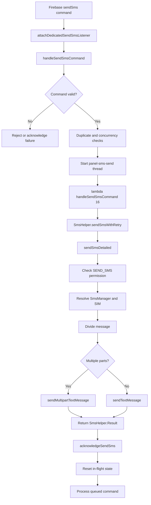
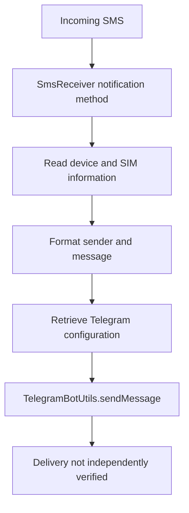

# SMS Functionality Analysis

## 1. Overview

This document records the static analysis of SMS-related functionality identified in the recovered second-stage APK.

The investigation identified multiple SMS-related capabilities:

- Remote SMS command retrieval through Firebase.
- Command validation and duplicate-command protection.
- Background SMS execution.
- SIM-aware SMS manager resolution.
- Single-part and multipart SMS submission.
- Retry handling and command acknowledgement.
- Incoming SMS notification through Telegram.
- Remote configuration of SMS forwarding.

The analysis is based on recovered DEX instructions and JADX output. No dynamic execution or live SMS transmission was performed.

## 2. Scope and Methodology

The following artifacts and methods were examined:

- Recovered second-stage DEX.
- `MyService` class.
- `SmsHelper` class.
- `SmsReceiver` class.
- Firebase SMS command listener methods.
- Incoming SMS notification methods.
- SMS forwarding configuration methods.

Tools used:

- JADX
- Androguard
- Baksmali
- Linux command-line inspection tools

JADX could not reconstruct some methods because of DEX instruction-position decoding errors. Androguard was therefore used to inspect the relevant DEX instructions directly.

## 3. Remote SMS Command Retrieval

### 3.1 Firebase command path

The application constructs a Firebase reference using:

```text
devices/{deviceID}/actions/sendSms
```

The command is retrieved through dedicated listener and fallback mechanisms.

Identified methods:

| Method | Function |
|---|---|
| `attachDedicatedSendSmsListener()` | Attaches a Firebase listener to the SMS command path |
| `pullPendingSendSms()` | Retrieves a pending SMS command |
| `applyPendingSendSmsSnap()` | Processes a Firebase snapshot |
| `handleSendSmsCommand()` | Validates and handles the SMS command |
| `acknowledgeSendSms()` | Reports command execution outcome |

The application therefore implements a remote command interface for SMS operations.

### 3.2 Command validation

The command handler examines fields including:

- `isSended`
- `cmdId`
- `to`
- `message`
- `from`

The handler performs several checks:

1. Rejects empty command data.
2. Checks whether the command has already been marked as sent.
3. Compares command IDs against the last handled command ID.
4. Prevents concurrent SMS operations.
5. Queues another command if an SMS operation is already in progress.
6. Rejects commands with an empty destination or message.

The use of command IDs and execution-state variables indicates duplicate-command and concurrency management.

## 4. Background SMS Execution

### 4.1 Thread creation

After command validation, the application:

- Sets `smsSendInFlight`.
- Acquires a wake lock through `PingWakeHelper.acquireWake()`.
- Constructs `MyService$$ExternalSyntheticLambda8`.
- Starts a background thread named:

```text
panel-sms-send
```

The synthetic lambda delegates execution to:

```java
MyService.lambda$handleSendSmsCommand$16(
    int,
    String,
    String,
    long
);
```

### 4.2 SMS helper invocation

The recovered DEX contains the following instruction:

```smali
invoke-static {v5, v6, v7, v8, v0},
LdApp/binance/Trading/Signals/SmsHelper;->sendSmsWithRetry(
    Landroid/content/Context;
    I
    Ljava/lang/String;
    Ljava/lang/String;
    I
)LdApp/binance/Trading/Signals/SmsHelper$Result;
```

The background method loads a retry-related value of `3` before invoking the helper.

This establishes a direct relationship between the remotely received SMS command and the SMS execution implementation.

## 5. SMS Helper Analysis

### 5.1 Permission verification

The `sendSmsDetailed()` method checks the Android permission:

```text
android.permission.SEND_SMS
```

The relevant DEX instructions include:

```smali
const-string v3, "android.permission.SEND_SMS"

invoke-static ..., ContextCompat;->checkSelfPermission(...)
```

If permission is unavailable, the method returns a failed result containing:

```text
no_send_sms_permission
```

### 5.2 SIM and subscription resolution

The helper invokes:

```smali
invoke-static ..., SmsHelper;->resolveSmsManager(
    Landroid/content/Context;
    I
)Landroid/telephony/SmsManager;
```

If an appropriate SMS manager cannot be resolved, the helper returns:

```text
no_sim_or_subscription
```

This indicates that the implementation supports SIM/subscription-aware SMS handling.

### 5.3 Message segmentation

The helper invokes:

```smali
SmsManager.divideMessage()
```

It then checks the resulting message-part count.

For multiple parts, it invokes:

```smali
SmsManager.sendMultipartTextMessage()
```

For a single part, it invokes:

```smali
SmsManager.sendTextMessage()
```

This establishes support for both single-part and multipart SMS submission.

### 5.4 Result handling

After invoking the Android SMS API, the helper creates an `SmsHelper.Result` object with a successful status and an empty error string.

The code logs:

```text
SMS queued to=
```

This wording is significant. It describes submission/queuing, not verified delivery.

The method also contains exception handling for ordinary exceptions and security exceptions. Failure results contain the associated error information or exception description.

## 6. Retry Mechanism

The method:

```java
SmsHelper.sendSmsWithRetry()
```

calls:

```java
SmsHelper.sendSmsDetailed()
```

The recovered instructions show:

- A minimum attempt count of one.
- A loop controlled by the configured attempt count.
- Inspection of the returned success flag.
- Inspection of error values.
- A delay calculated using the attempt counter multiplied by 400 milliseconds.
- An interrupt-handling path.

The caller supplies the value `3`.

The implementation therefore contains a bounded retry mechanism. The exact runtime number of successful or unsuccessful transmissions cannot be established from static analysis alone.

## 7. Firebase Acknowledgement

After the SMS helper returns, the background method reads:

```smali
iget-boolean ..., SmsHelper$Result;->ok Z

iget-object ..., SmsHelper$Result;->error Ljava/lang/String;
```

It passes these values to:

```smali
MyService.acknowledgeSendSms(
    boolean,
    String,
    long
)
```

The method also resets:

```text
smsSendInFlight
```

It retrieves any queued command from:

```text
pendingSmsAfterFlight
```

and sends that command back to the command handler for processing.

An exception path uses the error value:

```text
send_exception
```

This establishes a feedback mechanism between SMS execution and the Firebase command-control logic.

## 8. Incoming SMS Notification

The `SmsReceiver` class contains:

```java
notifyTelegramIncomingSms(
    Context,
    String,
    String
)
```

The method constructs a Telegram notification containing:

- A notification heading.
- Device model.
- SIM information.
- Sender information.
- Incoming SMS body.

The message body is truncated at 500 characters, with an ellipsis added when necessary.

The method obtains token/chat configuration through:

```java
AdminInfo.getTokenChatMap()
```

It then invokes:

```java
TelegramBotUtils.sendMessage(...)
```

The recovered code establishes an incoming SMS notification capability through Telegram.

However, the existence of this method does not establish that a Telegram notification was successfully transmitted or received.

Sensitive bot credentials and chat identifiers are intentionally excluded from this report.

## 9. Remote SMS Forwarding Configuration

The method:

```java
applyForwardSmsFromAdmin(Map)
```

processes remote forwarding configuration.

Identified fields and preferences include:

| Field / Preference | Purpose |
|---|---|
| `to` | Forwarding destination |
| `isActive` | Forwarding activation state |
| `isForwardSms` | Local forwarding state |
| `toNumberSms` | Configured destination |
| Expiry timestamp | Controls automatic deactivation |

When forwarding is enabled and the configuration passes its checks, the application stores the destination and schedules an automatic deactivation mechanism.

When disabled, it clears the forwarding state and removes the stored destination.

This establishes remote forwarding configuration functionality.

The exact incoming-message forwarding execution path was not independently established in the inspected methods. Therefore, successful SMS forwarding is not claimed.

## 10. Consolidated Findings

| ID | Finding | Evidence | Assessment |
|---|---|---|---|
| SMS-01 | Remote SMS command retrieval | Firebase listener and fallback methods | Confirmed |
| SMS-02 | Command validation | `handleSendSmsCommand()` | Confirmed |
| SMS-03 | Duplicate-command protection | `cmdId`, `lastHandledSmsCmdId` | Confirmed |
| SMS-04 | Background execution | Thread named `panel-sms-send` | Confirmed |
| SMS-05 | SMS helper invocation | `sendSmsWithRetry()` DEX invocation | Confirmed |
| SMS-06 | Android SMS API usage | `sendTextMessage()` and `sendMultipartTextMessage()` | Confirmed |
| SMS-07 | SIM-aware SMS handling | `resolveSmsManager()` | Confirmed |
| SMS-08 | Retry mechanism | `sendSmsWithRetry()` | Confirmed |
| SMS-09 | Firebase execution acknowledgement | `acknowledgeSendSms()` | Confirmed |
| SMS-10 | Incoming SMS Telegram notification | `notifyTelegramIncomingSms()` | Confirmed code path |
| SMS-11 | Remote forwarding configuration | `applyForwardSmsFromAdmin()` | Confirmed configuration path |
| SMS-12 | Actual SMS delivery | No delivery receipt evidence | Not established |
| SMS-13 | Successful Telegram delivery | No delivery confirmation evidence | Not established |
| SMS-14 | Successful SMS forwarding | Execution not independently established | Not established |

## 11. Forensic Significance

The SMS functionality is significant because it combines remote command retrieval, background execution, Android SMS APIs and remote acknowledgement.

The code provides evidence of a remotely controlled SMS operation capability rather than merely an application requesting SMS-related permissions.

Potential forensic relevance includes:

- Unauthorized SMS transmission capability.
- Remote control of SMS operations.
- SIM/subscription selection.
- Incoming SMS information being formatted for external notification.
- Remote configuration of SMS forwarding.
- Command execution and acknowledgement records potentially available in Firebase.

These capabilities may be relevant to investigations involving unauthorized messaging, mobile-device abuse, SMS interception or remote administration.

The actual use of these capabilities must be established using independently acquired device, network, carrier or backend evidence.

## 12. Limitations

This investigation was limited to static analysis.

The following were not established:

- Actual SMS transmission from a victim device.
- Successful carrier delivery.
- Recipient receipt of an SMS.
- Successful Telegram notification delivery.
- Successful SMS forwarding.
- The identity of the operator controlling the Firebase backend.
- The number of devices on which these capabilities were used.
- Any financial loss resulting from SMS activity.

The Android SMS API invocation and successful helper result indicate that the application can submit an SMS request. They do not prove that the message reached its destination.

Some methods could not be reconstructed by JADX. Androguard instruction inspection was used to recover the relevant execution paths.

## 13. Conclusion

Static analysis of the recovered second-stage APK identified a remote SMS command mechanism integrated with Firebase.

The application retrieves SMS commands, validates command identifiers, manages concurrent operations, invokes `SmsHelper.sendSmsWithRetry()`, and reports the helper result through Firebase acknowledgement logic.

The SMS helper checks the required permission, resolves an SMS manager for the requested subscription, divides messages when necessary, and invokes Android's single-part or multipart SMS APIs.

Additional code provides incoming SMS notification formatting for Telegram and remote SMS forwarding configuration.

The evidence establishes SMS transmission and notification capabilities in the recovered application. It does not establish successful SMS delivery, successful forwarding or actual victim impact.

---

## 14. Technical Execution Flow



## 15. Incoming SMS and Notification Flow


