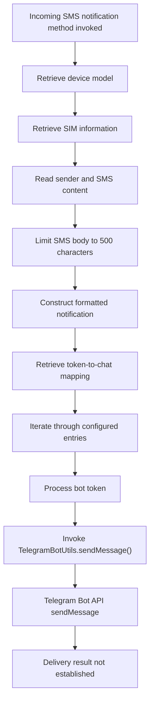

# Telegram Integration Analysis

## 1. Overview

This report documents the static analysis of Telegram-related functionality identified in the second-stage APK.

The investigation focuses on:

- Incoming SMS notification construction.
- Device and SIM information included in notifications.
- Telegram bot configuration and credential handling.
- Message delivery method.
- Forensic significance and limitations.

The analysis is based on recovered application code and DEX inspection.

**Analysis scope:** Static analysis only. No Telegram messages were sent, no bot credentials were tested, and no live Telegram API interaction was performed.

## 2. Identified Components

| Component | Recovered class or method | Purpose |
|---|---|---|
| SMS notification handler | `SmsReceiver.notifyTelegramIncomingSms(Context,String,String)` | Constructs Telegram notification |
| Bot configuration | `AdminInfo.getTokenChatMap()` | Retrieves token-to-chat configuration |
| Credential handling | `FieldCrypto.revealBotToken(String)` | Reveals and validates bot token |
| Telegram communication | `TelegramBotUtils.sendMessage(...)` | Invokes Telegram message-sending functionality |
| Telegram API | `api.telegram.org` | Telegram Bot API host |

The recovered code establishes a Telegram notification functionality associated with incoming SMS processing.

## 3. Incoming SMS Notification Construction

The method:

```java
SmsReceiver.notifyTelegramIncomingSms(
    Context,
    String,
    String
)
```

constructs a Telegram notification when invoked.

The generated notification contains the heading:

```text
📥 NEW MESSAGE RECEIVED
```

The message-building logic includes the following information:

| Field | Source | Purpose |
|---|---|---|
| Device model | `Build.MODEL` | Identifies device model |
| SIM 1 information | `SimInfoUtil` | Retrieves SIM 1 information |
| SIM 2 information | `SimInfoUtil` | Retrieves SIM 2 information |
| Sender | Method argument | Identifies SMS sender |
| Message body | Method argument | Includes incoming SMS content |

### 3.1 Message-body handling

The recovered implementation limits the included SMS body to 500 characters.

When the content exceeds the configured limit, it is truncated and an ellipsis is appended.

This indicates that the notification is designed to include a portion of the incoming SMS content rather than necessarily transmitting the complete message.

### 3.2 HTML formatting

The notification is constructed using Telegram HTML-style formatting.

The recovered implementation escapes HTML-sensitive characters in device-model and SIM-related values before including them in the notification.

The message uses HTML formatting for its heading and information fields.

The exact sanitization behaviour should not be generalized to every message field without inspecting the complete message-building instructions.

## 4. Telegram Bot Configuration

The notification method retrieves a token-to-chat mapping through:

```java
AdminInfo.getTokenChatMap();
```

The recovered code iterates over the returned map entries.

Each entry represents a bot-token and chat-destination configuration.

The method then passes the corresponding values and constructed notification to:

```java
TelegramBotUtils.sendMessage(...)
```

This indicates that the implementation supports sending the notification to configured Telegram chat destinations.

The exact number of configured bots or recipients has not been established.

### 4.1 Credential handling

The class:

```text
FieldCrypto
```

contains the method:

```java
revealBotToken(String)
```

The recovered implementation performs token-recovery and validation operations, including:

- Processing the supplied token representation.
- Trimming whitespace.
- Checking that the result is not empty.
- Checking that the result is not still in the expected encrypted representation.
- Checking for a colon separator.
- Checking that the resulting token has a minimum length of 20 characters.

These checks are consistent with validation of a Telegram bot-token-like value.

**Credential safety:** Actual bot tokens, chat identifiers and other sensitive configuration values are intentionally excluded from this report.

The presence of this method does not establish the identity or ownership of the bot.

## 5. Telegram API Communication

The recovered Telegram communication functionality is associated with the Telegram Bot API `sendMessage` method.

The API endpoint template is:

```text
https://api.telegram.org/bot<TOKEN>/sendMessage
```

The endpoint accepts a bot token as part of its URL path.

The recovered application code delegates message transmission to:

```java
TelegramBotUtils.sendMessage(...)
```

This establishes the presence of a Telegram message-sending code path.

However, the complete request construction, response processing and delivery result have not been independently verified in this analysis.

### 5.1 Delivery status

The following distinctions are important:

| Observation | Assessment |
|---|---|
| Telegram notification construction | Confirmed |
| Incoming SMS content included in notification | Confirmed |
| Device model included | Confirmed |
| SIM-related information included | Confirmed |
| Bot-token and chat mapping retrieved | Confirmed |
| Telegram send method invoked | Confirmed |
| Successful Telegram API response | Not established |
| Successful message delivery | Not established |
| Actual recipient identity | Not established |

A call to a message-sending method does not prove that Telegram accepted the request or delivered the message.

## 6. Reconstructed Notification Workflow

The recovered code supports the following workflow:

1. The SMS notification method receives its context and SMS-related arguments.
2. It retrieves device-model information.
3. It obtains SIM-related information.
4. It constructs a notification heading and body.
5. It includes the sender and SMS content.
6. It truncates long SMS content to the configured limit.
7. It retrieves the bot-token-to-chat mapping.
8. It iterates through the configured entries.
9. It invokes the Telegram message-sending method for the corresponding configuration.

This establishes the intended notification workflow, not successful execution on a real device.

## 7. Security and Forensic Significance

### 7.1 SMS content disclosure

The most significant observation is that incoming SMS content is incorporated into an outgoing Telegram notification.

SMS messages may contain:

- One-time passwords.
- Account verification codes.
- Banking notifications.
- Payment alerts.
- Personal communications.
- Authentication-related information.

The recovered implementation therefore represents a potential SMS confidentiality risk.

Whether sensitive information was actually transmitted depends on runtime execution, configuration and successful Telegram delivery.

### 7.2 Device and SIM information disclosure

The notification also includes device-model and SIM-related information.

This could expose device and telecommunications context to the configured Telegram destination.

The actual sensitivity and completeness of the transmitted SIM information depend on the values returned by the SIM utility.

### 7.3 External messaging channel

The use of a Telegram bot provides an external messaging channel for notification data.

This is relevant to forensic investigations because evidence of Telegram-related code can help explain a possible communication path between an application and an external recipient.

However, the Telegram API itself is a legitimate service. Its presence alone is not an indicator that the destination is malicious.

### 7.4 Credential protection and exposure

The application contains a token-recovery and validation method.

Bot credentials are sensitive because possession of a valid bot token can permit interaction with the corresponding bot through the Telegram API, subject to Telegram's controls.

Actual credentials should not be included in public repositories, reports or screenshots.

## 8. Indicators and Technical Observations

| Indicator | Value | Interpretation |
|---|---|---|
| Telegram API host | `api.telegram.org` | Telegram Bot API host |
| API operation | `sendMessage` | Sends Telegram messages |
| Notification method | `notifyTelegramIncomingSms` | Constructs SMS notification |
| Bot configuration method | `getTokenChatMap` | Retrieves token-to-chat mappings |
| Token handling method | `revealBotToken` | Processes and validates bot token |
| Notification heading | `NEW MESSAGE RECEIVED` | SMS notification heading |
| SMS body limit | 500 characters | Maximum included message-body length before truncation |
| Message format | Telegram HTML-style formatting | Formatted notification content |

The Telegram API host is a legitimate service endpoint and should not independently be classified as malicious.

No actual bot token or chat ID is reproduced.

## 9. Limitations

This analysis is based on static application code.

The following have not been established:

- Successful retrieval of a valid Telegram bot token.
- Actual bot-token ownership.
- Actual chat recipient identity.
- Successful Telegram API authentication.
- Successful HTTP response from Telegram.
- Successful Telegram message delivery.
- Actual transmission of victim SMS messages.
- Number of messages transmitted.
- Whether any transmitted messages contained OTPs or banking information.
- Whether the Telegram configuration was active during application execution.

The existence of a Telegram notification method does not prove that the method was executed on a victim device.

## 10. Conclusion

The second-stage APK contains a Telegram notification implementation associated with incoming SMS processing.

The recovered method constructs notifications containing the device model, SIM-related information, SMS sender and incoming message content. The SMS body is limited to 500 characters before truncation.

The implementation retrieves bot-token-to-chat mappings and invokes a Telegram message-sending method for the configured entries. A separate credential-handling method processes and validates bot-token-like values.

**Final assessment:** The APK contains a confirmed code path designed to forward incoming SMS-related information through Telegram bot messaging. This creates a potential SMS and device-information disclosure risk. However, successful bot authentication, actual message transmission and delivery to a recipient have not been established through static analysis.

---

## 11. Notification Workflow Diagram

The following diagram represents the recovered Telegram notification code path.



**Diagram note:** This is a static reconstruction of the application code path. It does not represent a verified Telegram API transaction.
