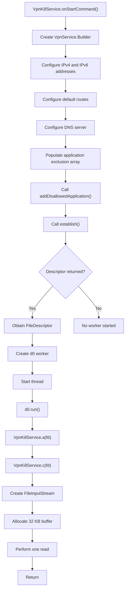

# VPN Service Analysis

## 1. Overview

This document presents the static analysis of the VPN implementation identified in the first-stage APK.

The analysis focuses on the Android `VpnService` implementation, VPN interface configuration, routing rules, application exclusions, worker-thread execution and packet-handling behaviour.

The investigation was conducted through direct DEX instruction inspection using Androguard because JADX encountered instruction-decoding errors while decompiling multiple methods.

**Analysis scope:** Static analysis only. No VPN runtime behaviour or live network traffic was tested.

## 2. Identified Components

| Component | Class / Method | Purpose |
|---|---|---|
| VPN service | `com.wehfejg.asdfhew.VpnKillService` | Implements Android VPN service |
| Service initialization | `onStartCommand()` | Configures and establishes VPN interface |
| Service cleanup | `onDestroy()` | Invokes VPN cleanup |
| Descriptor handler | `a(FileDescriptor)` | Delegates descriptor processing |
| Descriptor reader | `c(FileDescriptor)` | Reads from VPN interface descriptor |
| Worker class | `d0` | Executes descriptor-processing method |
| Network utility | `dApp.binance.Trading.Signals.NetworkUtil` | Checks network connectivity and VPN status |

The `VpnKillService` class extends Android's `android.net.VpnService`.

## 3. VPN Interface Configuration

The recovered `onStartCommand()` method creates an instance of:

```java
new VpnService.Builder(this);
```

It configures the following virtual network addresses and routing rules.

### 3.1 Interface addresses

| Configuration | Value |
|---|---|
| IPv4 address | `10.0.0.2` |
| IPv4 prefix length | `32` |
| IPv6 address | `fd00::2` |
| IPv6 prefix length | `128` |

The application assigns private IPv4 and IPv6 addresses to the virtual VPN interface.

### 3.2 Routing configuration

The following calls are present:

```java
builder.addRoute("0.0.0.0", 0);
builder.addRoute("::", 0);
```

These configure default routes for IPv4 and IPv6 respectively.

The configuration is intended to route all destinations covered by those address families into the VPN interface, subject to the application's VPN exclusion rules.

This is significant because it is broader than configuring a route to a single destination.

### 3.3 DNS configuration

```java
builder.addDnsServer("10.0.0.1");
```

The application configures `10.0.0.1` as the VPN interface's DNS server.

The static code establishes the configured DNS address. It does not establish that a DNS server is reachable or that DNS queries are successfully forwarded.

### 3.4 VPN session name

```java
builder.setSession("System");
```

The VPN session is assigned the name `System`.

The session name alone does not establish that the VPN is an Android system service or a legitimate system-managed VPN provider.

## 4. Application Exclusion Analysis

The service invokes:

```java
builder.addDisallowedApplication(packageName);
```

The recovered DEX instructions contain these package-name strings:

| Package name | Application association |
|---|---|
| `com.whatsapp` | WhatsApp |
| `com.whatsapp.w4b` | WhatsApp Business |
| `com.gbwhatsapp` | GBWhatsApp |
| `org.telegram.messenger` | Telegram |
| `org.telegram.messenger.web` | Telegram Web |
| `com.facebook.orca` | Facebook Messenger |
| `com.google.android.dialer` | Google Dialer |
| `com.android.dialer` | Android Dialer |
| `com.samsung.android.dialer` | Samsung Dialer |
| `com.miui.voiceassist` | MIUI Voice Assistant |
| `com.google.android.apps.meetings` | Google Meet |
| `com.skype.raider` | Skype |

### 4.1 Important DEX indexing observation

The recovered instruction sequence requires an additional qualification.

The code allocates a 12-element string array:

```text
new-array v1, v7, [Ljava/lang/String;
```

The recovered assignments begin at array index `1`, not index `0`.

Additionally, the first two package assignments both use index `1`:

```text
com.whatsapp       -> index 1
com.whatsapp.w4b   -> index 1
```

The second assignment therefore overwrites the first.

The subsequent assignments populate indices `2` through `11`. Index `0` appears uninitialized.

The loop iterates over all 12 positions, starting at index `0`, and passes each value to `addDisallowedApplication()`.

**Forensic significance:**

- `com.whatsapp` appears to be overwritten before the loop.
- The first array element appears to be null.
- The loop attempts to pass the first array element to `addDisallowedApplication()`.
- The resulting runtime behaviour has not been verified.

Depending on Android API behaviour and exception handling, this may cause the VPN configuration process to fail before `establish()` is reached.

Therefore, the 12 package strings are recovered configuration values, but successful exclusion of all 12 applications must not be claimed.

## 5. VPN Interface Establishment

The service calls:

```java
builder.establish();
```

The returned `ParcelFileDescriptor` is stored in the service field:

```text
VpnKillService.a
```

The code then checks whether the returned descriptor is null.

If it is non-null, the service:

1. Obtains the underlying `FileDescriptor`.
2. Creates a new worker object of class `d0`.
3. Creates a Java thread using that worker.
4. Starts the thread.

This establishes that the application attempts to create a VPN interface and starts a worker when a non-null descriptor is returned.

However, the static code does not establish that the user granted VPN permission, that `establish()` succeeded on an actual device, or that the VPN remained operational.

## 6. Worker Thread Analysis

The worker class `d0` was inspected directly through Androguard.

### 6.1 Constructor

Recovered signature:

```text
<init>(Ljava/io/FileDescriptor;)V
```

The constructor stores the supplied file descriptor:

```text
iput-object v1, v0, Ld0;->a Ljava/io/FileDescriptor;
```

This associates the VPN interface descriptor with the worker object.

### 6.2 run() method

Recovered signature:

```text
run()V
```

The instructions are:

```text
iget-object
invoke-static VpnKillService.a(FileDescriptor)
return-void
```

The worker retrieves its stored descriptor and passes it to `VpnKillService.a()`.

The method `a()` delegates to `VpnKillService.c()`.

## 7. VPN Packet-Handling Analysis

The recovered `VpnKillService.c(FileDescriptor)` method contains the following operations:

```java
FileInputStream input = new FileInputStream(fileDescriptor);

byte[] buffer = new byte[32768];

int bytesRead = input.read(buffer);

if (bytesRead < 0) {
    return;
}

return;
```

This is a simplified representation of the recovered DEX instructions, not a claim that JADX successfully reconstructed the original Java source.

### 7.1 Observed behaviour

The method:

1. Creates a `FileInputStream` using the supplied VPN file descriptor.
2. Allocates a 32 KB byte buffer.
3. Performs one read operation.
4. Checks whether the returned value is negative.
5. Returns from the method.

The recovered implementation does not demonstrate:

- A continuous packet-reading loop.
- A packet-processing pipeline.
- A remote VPN server connection.
- Forwarding packets to another network interface.
- Writing packets back to the VPN interface.
- DNS request forwarding.
- An identifiable tunnelling protocol.

### 7.2 Forensic interpretation

Android VPN interfaces expose IP packets through a file descriptor. A functional packet-forwarding implementation ordinarily needs to process packets continuously and provide an appropriate forwarding mechanism.

The inspected worker path performs only one input read and does not show a corresponding packet-forwarding or output-writing operation.

Consequently, **the inspected execution path does not demonstrate a complete functional VPN tunnel**.

If this is the only packet-processing path, it would not provide normal bidirectional VPN forwarding and could result in traffic being left unprocessed or disrupted.

This conclusion is limited to the recovered methods. Other packet-processing mechanisms elsewhere in the application have not been ruled out.

## 8. VPN Cleanup Behaviour

The recovered `onDestroy()` method invokes:

```java
VpnKillService.b();
```

The cleanup method:

1. Retrieves the service instance.
2. Checks whether a `ParcelFileDescriptor` exists.
3. Closes the descriptor when present.
4. Stops the foreground service.
5. Calls `stopSelf()`.
6. Clears the stored service reference.

This demonstrates an explicit VPN service cleanup path.

It does not establish whether cleanup was executed during actual application operation.

## 9. Second-Stage Network Utility Analysis

The second-stage APK contains:

```text
dApp.binance.Trading.Signals.NetworkUtil
```

This class provides several network-state checks.

| Method | Observed functionality |
|---|---|
| `getActiveNetworkType()` | Identifies Wi-Fi, mobile, Ethernet, Bluetooth, VPN or unknown transport |
| `hasInternetConnectivity()` | Attempts DNS resolution of `www.google.com` |
| `isAirplaneModeOn()` | Checks Android airplane-mode setting |
| `isBluetoothConnected()` | Checks Bluetooth network connectivity |
| `isMobileDataConnected()` | Checks mobile network connectivity |
| `isNetworkConnected()` | Checks active network capabilities |
| `isNetworkMetered()` | Checks whether the active network is metered |
| `isNetworkRoaming()` | Checks roaming status |
| `isVpnConnected()` | Checks for VPN transport |
| `isWifiConnected()` | Checks Wi-Fi connectivity |

### 9.1 VPN detection

The `isVpnConnected()` method retrieves the active network's capabilities and checks:

```java
networkCapabilities.hasTransport(4);
```

The transport value `4` represents VPN transport.

This method detects VPN network transport. It does not establish a VPN connection or demonstrate packet interception.

### 9.2 Network connectivity check

The `hasInternetConnectivity()` method attempts to resolve:

```text
www.google.com
```

It uses `InetAddress.getByName()` and returns a Boolean result based on the resolution.

This is a DNS-resolution-based connectivity check, not a comprehensive test of internet reachability or application-server availability.

## 10. Indicators and Technical Observations

| Indicator | Value | Interpretation |
|---|---|---|
| VPN service class | `com.wehfejg.asdfhew.VpnKillService` | Android VPN service |
| VPN session | `System` | Configured session name |
| IPv4 interface | `10.0.0.2/32` | Virtual interface address |
| IPv6 interface | `fd00::2/128` | Virtual interface address |
| IPv4 route | `0.0.0.0/0` | Default IPv4 route |
| IPv6 route | `::/0` | Default IPv6 route |
| DNS server | `10.0.0.1` | Configured VPN DNS |
| Worker class | `d0` | VPN descriptor worker |
| Packet buffer | 32768 bytes | Input buffer allocation |
| Network detection host | `www.google.com` | DNS-resolution check |

These are configuration and code indicators. They are not proof of a successful VPN connection or malicious network activity.

## 11. Security and Forensic Significance

The VPN implementation deserves attention for the following reasons:

1. **Broad routing configuration:** The service configures default IPv4 and IPv6 routes, indicating an intention to direct a broad range of traffic into the VPN interface.

2. **Communication application exclusions:** Multiple messaging, calling and communication application package names are present in the exclusion configuration. The array-indexing issue means their successful exclusion is not established.

3. **Incomplete packet-processing path:** The recovered worker performs one read and does not demonstrate a forwarding mechanism.

4. **Potential connectivity impact:** If the recovered implementation is the only packet-processing path and the VPN interface is successfully established, traffic routed into the interface may not receive normal forwarding.

5. **Runtime uncertainty:** The static evidence cannot establish whether the VPN interface was successfully created or whether the service was operational on a device.

6. **Relationship to other application behaviour:** The VPN component exists alongside other network-related functionality in the APK. Their presence in the same application does not, by itself, prove that VPN traffic is used to collect or transmit credentials, SMS messages or other data.

## 12. Limitations

This investigation was limited to static inspection of recovered DEX instructions and related application code.

The following have not been established:

- Successful VPN permission approval.
- Successful creation of the VPN interface on a device.
- Actual traffic capture.
- Actual traffic forwarding or interception.
- Remote VPN endpoint identity.
- DNS resolution through the configured VPN DNS server.
- Successful exclusion of the listed applications.
- Actual credential or SMS transmission through the VPN interface.
- Runtime behaviour of the service.

JADX encountered instruction-decoding errors in multiple methods. The relevant VPN methods were therefore inspected using Androguard rather than relying on JADX's reconstructed Java output.

## 13. Conclusion

The first-stage APK contains an Android `VpnService` implementation that configures IPv4 and IPv6 virtual addresses, default routes and a DNS server.

It attempts to establish a VPN interface and starts a worker thread that receives the interface's file descriptor.

However, the recovered worker implementation performs a single read from the VPN descriptor and returns. The inspected code does not demonstrate continuous packet processing, bidirectional forwarding or communication with a remote VPN server.

An additional array-indexing issue was identified in the application-exclusion configuration: the first package assignment is overwritten, and the first array element appears uninitialized.

**Final assessment:** VPN service implementation and broad routing configuration are confirmed. A complete functional VPN tunnel, successful traffic interception and data exfiltration through the VPN are not demonstrated by the recovered static code.

---

## 14. Execution Flow Diagram

The following diagram represents the recovered VPN execution path.



**Diagram note:** This represents the recovered instruction sequence, not a verified runtime execution trace.
